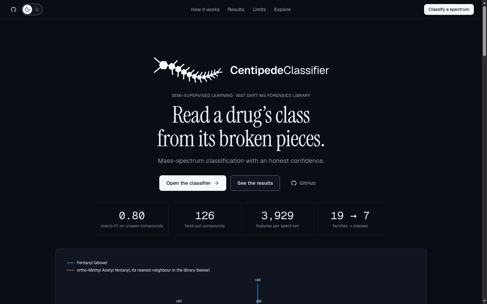
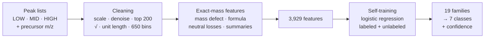
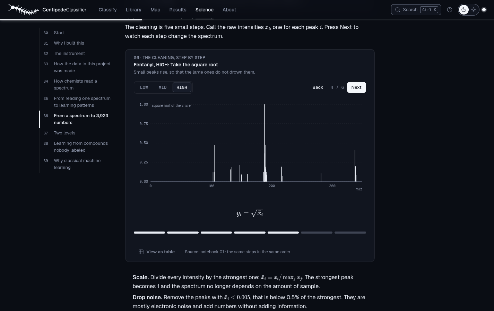
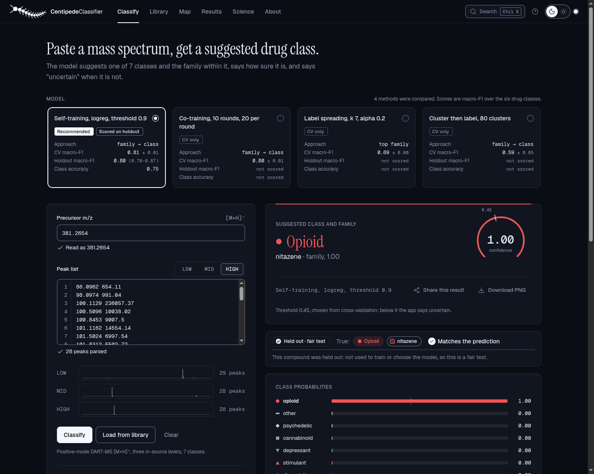
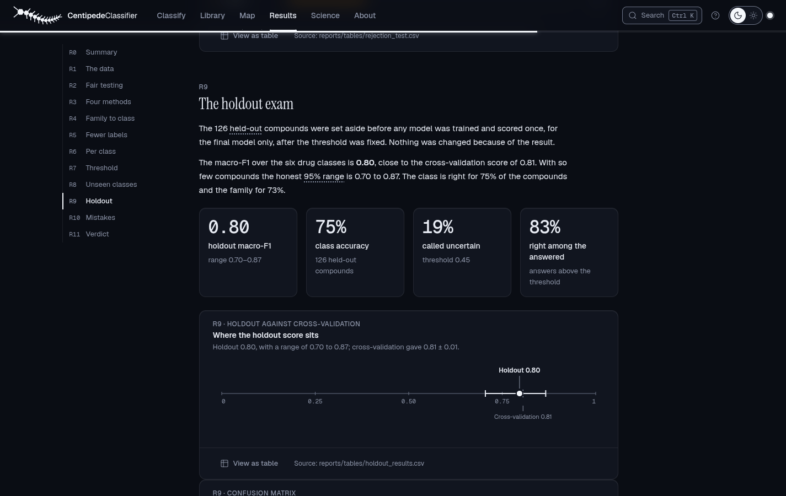

<p align="center">
  <picture>
    <source media="(prefers-color-scheme: dark)" srcset="app/frontend/public/brand/centipede-C-segments-sharp-white-horizontal.svg">
    
  </picture>
</p>

<h3 align="center">Read a drug's class from its broken pieces.</h3>

<p align="center">
  Semi-supervised classification of drugs from DART-MS spectra,<br>
  with a confidence score and the option to abstain.
</p>

<p align="center">
  
  
  
  
</p>

<p align="center">
  
</p>

## What it does

A mass spectrum is a fingerprint of the pieces a molecule breaks into. CentipedeClassifier takes the spectra of an unknown compound, measured at three fragmentation levels, and suggests its **chemical family** (19) and **drug class** (7: stimulant, depressant, opioid, cannabinoid, psychedelic, dissociative, other). Every prediction comes with a confidence, and below a threshold the model **abstains** instead of guessing.

Only a minority of the library could be labeled, so the model learns from both labeled and unlabeled spectra with **self-training**, a semi-supervised method.

## Results

Evaluated with grouped cross-validation (close structural relatives never straddle a split) and a holdout set scored once at the very end.

| | |
|---|---|
| Holdout macro-F1 over the six drug classes | **0.80** (95% bootstrap interval 0.70 to 0.87, 126 compounds) |
| Cross-validation macro-F1 | 0.81 ± 0.01 (5 folds × 3 repeats) |
| Holdout accuracy, 7 classes / 19 families | 0.75 / 0.73 |
| Abstains below a confidence of 0.45 | 19% of the holdout; 83% of the answered ones are right |
| Majority-class baseline | 0.06 |

The four semi-supervised methods that were compared (best setting of each, cross-validation macro-F1 over the six drug classes):

| Method | Macro-F1 |
|---|---|
| Self-training with logistic regression (final model) | 0.806 ± 0.013 |
| Co-training on two views of the features | 0.798 ± 0.008 |
| Label spreading | 0.691 ± 0.004 |
| Cluster, then label | 0.587 ± 0.048 |

More labels help: the final model scores 0.48, 0.59, 0.72 and 0.81 with 10%, 20%, 50% and all of the training labels.

## How it works



| Feature group | Features |
|---|---|
| Spectra: three levels of 650 one-unit m/z bins, and the precursor m/z | 1,951 |
| A. Mass defect, nitrogen rule, Kendrick defect, fragment defect | 6 |
| B. Candidate molecular formula from the precursor mass (weighted atom counts, double-bond equivalents) | 10 |
| C. Neutral losses (precursor m/z minus fragment m/z), three levels of 650 bins | 1,950 |
| D. Spectrum summaries (peak count, base peak, share above half the precursor, intact ion) | 12 |

The Science page of the app walks through every step with interactive figures.

<p align="center">
  
  
</p>

## Evaluation protocol

- **Unit of splitting: the compound.** A compound has three spectra and many have near-identical analogs, so compounds are grouped by structural similarity (Morgan fingerprints, Tanimoto, Butina clustering, cutoff chosen per family) and a whole group goes to one side.
- **Holdout:** 20% of the labeled compounds are set aside first and scored once, after the model, the features and the threshold were fixed.
- **Model selection:** grouped 5-fold cross-validation repeated 3 times on the rest; the unlabeled pool never contains a test compound.
- **Threshold:** the lowest confidence at which at least 85% of the answered compounds are right in cross-validation while at least 60% are answered.

<p align="center">
  
</p>

## Scope and limits

- It is a screening aid: a prediction is a ranked hypothesis, and identification still needs confirmation with reference methods.
- It reads positive-mode DART-MS spectra measured at the library's LOW, MID and HIGH levels.
- Compounds outside the 19 families, including ordinary medicines that resemble drugs, are handled less reliably: a class hidden from training is flagged as uncertain only 32% of the time, against 22% for normal predictions. The heterogeneous "other" class reaches 72% recall at 46% precision.
- The labels are hand-curated by one person; the holdout has 126 compounds, so the intervals are wide.

The Results page of the app shows every table and figure behind these numbers.

## Repository

```
notebooks/   01 prepare data · 02 exact-mass features · 03 labels · 04 split · 05 train and compare · 06 final model
data/labels/ the hand-checked labels, the family-to-class table, the split
models/      the four trained semi-supervised models (scikit-learn 1.5.2)
reports/     tables/ and figures/ written by the notebooks
scripts/     export_app_data.py (data for the app) · check_app_features.py (app features against the notebooks)
app/backend  FastAPI service: loads the models, builds the same 3,929 features, serves predictions
app/frontend Next.js app: landing page, classifier, library, map, results, science
assets/      screenshots
```

## Run it

**Data.** The NIST DART-MS Forensics Database ("Locust" library, positive mode, helium, SDF) is not redistributed here. Download it from [data.gov](https://catalog.data.gov/dataset/nist-dart-ms-forensics-database-is-cid) (released under the [NIST open licence](https://www.nist.gov/open/license)) and put `HePos_Locust.SDF` in `data/raw/locust/`.

**Notebooks.**

```bash
python -m venv .venv && source .venv/bin/activate
pip install -r requirements.txt
jupyter lab            # run notebooks/01 to 06 in order (05 takes about half an hour on 4 cores)
```

**App.**

```bash
python scripts/export_app_data.py                     # writes app/backend/data from the notebooks' outputs

cd app/backend
python -m venv .venv && .venv/bin/pip install -r requirements.txt
.venv/bin/uvicorn main:app --port 8000                # backend on :8000

cd ../frontend
npm install && npm run dev                            # frontend on :3000
```

The backend needs scikit-learn 1.5.2, the version that wrote the saved models. `scripts/check_app_features.py` confirms that the app builds exactly the notebook's features for all 1,570 compounds.

## Credits

Spectra and structures: [NIST DART-MS Forensics Database](https://catalog.data.gov/dataset/nist-dart-ms-forensics-database-is-cid) ("Locust" library, in-source CID). NIST is not affiliated with this project.

A machine-learning mini project for the Machine Learning course at ESI-SBA, by [solxire](https://solxire.dev).
